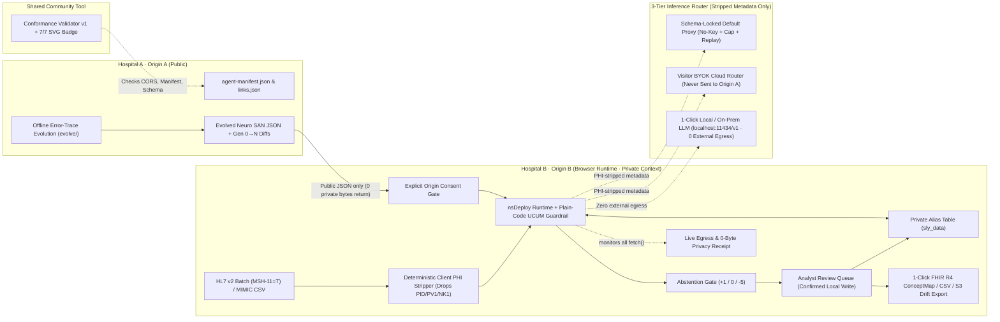

# Dialect

[](LICENSE)
[](https://cognizant-agenticweb.devpost.com/)
[](docs/data-and-scenarios.md)
[](PLAN.md)

**An open agentic mapping and LIS-migration workbench that translates each hospital's local lab codes to LOINC, abstains (`+1 / 0 / -5`) instead of guessing, strips PHI deterministically in the browser, adapts locally without sending hospital data to peer sites, and exports deployable FHIR R4 `ConceptMap` / CSV tables.**

Entry for the [Open Agentic Web Challenge](https://cognizant-agenticweb.devpost.com/) (Cognizant, MIT NANDA, Mozilla, AWS, UN ITU-T SG17, UT Austin, AI Commons). Hard deadline: Mon 11 Jan 2027, 8:00 am PST (16:00 UTC); target submission: **Sun 10 Jan 2027**.

> **Synthetic scenario & non-clinical notice.** Real public standards (HL7 v2, LOINC, UCUM) and real public lab labels (MIMIC-IV Clinical Database Demo v1.0, ODbL); fictional hospitals and patients (`MSH-11=T`, `SYNTHETIC^PATIENT`). **Not a clinical tool.** Every write and export requires explicit human analyst approval.

**Current status (24 Nov 2026):** Scope-locked pre-build (Gate G1). Application code and benchmark runs begin in P1/P2. Every factual statistic below is sourced in [docs/facts.md](docs/facts.md); experimental numbers will be populated strictly from `results.json` after P1 and P4.

---

## 30-Second Summary

### The real-world problem
Hospitals exchange lab results using HL7 v2 and LOINC, yet every lab speaks its own local "dialect" of codes, abbreviations, specimen phrasing, and units (`mg/dL` vs. `mmol/L`). As AHRQ documents, *"supports HL7"* does not guarantee interoperability: in one five-hospital AHRQ project, **14,802 local interface codes** had to be reconciled down to **4,051 unique LOINC codes** ([docs/facts.md](docs/facts.md)). Existing tools leave an unsolved gap: manual RELMA mapping is slow; standalone AI mappers (such as LabBridge at 81–90% accuracy) still force analysts to audit every prediction because they do not reliably flag uncertain guesses; and central mapping SaaS vendors require hospitals to upload local catalogs to a third-party platform.

### Why Open Agentic Websites (and not a central SaaS)?
The Open Agentic Web separates **public, inspectable agent networks** from **site-private browser context (`sly_data`)**. Dialect uses that exact architectural inversion—**"the mapping skill travels to the hospital's browser; the hospital's codes and approvals never go to peer sites"**:

1. **Asymmetric safety (`+1 / 0 / -5`):** Correct mappings score `+1`, honest abstentions (*"please check"*, with top-3 candidates and reason) score `0`, and confident wrong mappings incur `-5`. Plain TypeScript guardrails enforce UCUM unit compatibility and deterministic PHI stripping—never LLM prompt instructions.
2. **Workbench output, not a live Chrome router:** Real hospitals execute pre-approved mapping tables server-side in interface engines (Mirth Connect, Rhapsody, Cloverleaf). Dialect acts as a zero-install **onboarding and LIS-migration drift workbench** whose human-approved queue ends with **1-click FHIR R4 `ConceptMap` JSON, CSV, and S3 Drift-Diff exports**.
3. **Auditable error-trace evolution (`Gen 0 → Gen N`):** Offline evolution mutates concrete Neuro SAN disambiguation rules directly from `-5` error traces and publishes every generation's resolved JSON, held-out score, and human-readable rule diffs on the open web.
4. **Dual challenge contribution:** Dialect ships both **two live agentified hospital websites** (Origin A and Origin B) and **reusable community infrastructure**—including **Conformance Validator v1 + embeddable `OAW Spec 7/7 Pass` SVG badge** filling the open validation-script `TODO` in [`cognizant-ai-labs/agentic-web`](https://github.com/cognizant-ai-labs/agentic-web).

---

## Architecture & Privacy Trust Boundaries



### Explicit Privacy & Data Egress Guarantees
We state every boundary plainly—no vague *"data never leaves"* claims:

| Boundary | What crosses it | How it is enforced & verified |
|---|---|---|
| **Peer Site (Origin A)** | **0 bytes** of Hospital B's lab batches, alias table (`sly_data`), or visitor BYOK key | Explicit origin consent + exact-name peer fetch only; verified live by Hospital B's **Live Egress & 0-Byte Privacy Receipt** (`fetch()` + `PerformanceResourceTiming` ledger, downloadable JSON) |
| **Chosen Cloud LLM Router** *(Default Proxy or BYOK)* | **De-identified catalog metadata only** (`OBX-3` code/label, `OBX-6` unit, `OBX-7` range) | Plain-TypeScript **Client PHI Stripper** removes `PID`, `PV1`, `NK1`, `NTE`, patient IDs, and timestamps pre-call, with a visible stripped-payload preview in the UI; default proxy is **schema-locked** to lab-mapping payloads with IP rate limits, provider spend caps, and a labelled replay fallback |
| **Local / On-Prem LLM Preset** *(Optional BYOK)* | **0 external network bytes** | 1-click OpenAI-compatible preset (`localhost:11434/v1` for local Ollama/vLLM servers) demonstrating a true zero-egress deployment path for hospital IT |

---

## Judging Criteria Alignment (Human Judges & Automated AI Screeners)

### Stage One Conformance (Pass/Fail)
Dialect deploys two public HTTPS Vercel origins (**Hospital A** and **Hospital B**) built on the Apache-2.0 `nsDeploy` reference runtime, publishing conforming `agent-manifest.json`, fully resolved Neuro SAN `.json` networks with front agent, `links.json`, CORS headers, a working no-key default router, visitor BYOK settings, explicit cross-origin consent, confirmed local actions, and all four required visible error stops. Every artifact is verified automatically by our own **Conformance Validator v1** (and checked in CI via `verify:docs`), delivering both **agentified websites** and **community trust/validation infrastructure**.

### Technological Implementation
Dialect implements a multi-agent Neuro SAN pipeline (HL7 parser, mapper, front agent) paired with deterministic plain-TypeScript safety code (UCUM unit guardrail and client-side PHI stripper), WebMCP-aligned human-confirmed local site actions (`save_mapping` and `export_concept_map`), and a live **0-Byte Privacy Receipt** inspector. Offline evolution mutates interpretable disambiguation rules directly from `-5` error traces and publishes readable `Gen 0 → Gen N` JSON diffs, while GitHub Actions runs unit tests and `verify:docs` schema/`facts.md` parity checks on every push.

### Design
Dialect delivers one cohesive, zero-install analyst workflow from start to finish: paste or load a synthetic HL7 batch (or MIMIC catalog) → inspect the PHI-stripped payload → review confident matches and the *"ask a human"* queue (top-3 candidates + reason) → confirm local writes to Hospital B's private alias table → watch unseen-code accuracy rise → click once to export valid **FHIR R4 `ConceptMap` JSON, interface-engine CSV, or an S3 Drift-Diff report**. The interface works with no API key on laptop and mobile, and will be validated via a timed unassisted 3-user study (target: `<3 min`, planned in P4).

### Potential Impact
Dialect targets a documented, high-cost pain point for small/mid-sized hospital interface analysts, HIEs, and integration teams (AHRQ: 14,802 local codes → 4,051 LOINC codes across 5 hospitals), benchmarked separately on **269 real public hospital lab labels** from MIMIC-IV Demo v1.0 (`S2a` vs. `S2b`) and backed by a planned practitioner review quote. Beyond the hospital sites, Dialect ships four reusable open-source community tools—starting with **Conformance Validator v1 + embeddable `OAW Spec 7/7 Pass` SVG badge** (filling Cognizant's open validation `TODO`, launching mid-December in GitHub Discussions), an open **`DialectProfile` v1 JSON schema**, a synthetic HL7 dialect generator, and the `+1 / 0 / -5` abstain-aware scorer.

### Quality of the Idea
Dialect gives the Open Agentic Web a high-stakes enterprise reason to exist—inverting central healthcare SaaS so shared mapping skill travels to private browser context while enforcing clinically legible `-5` abstention safety. To prove genuine dialect adaptation rather than hash-map caching or prompt-tuning hype, we pre-registered a strict Gate G2 kill rule requiring wins against **both** forced-choice and **abstain-prompted single-LLM baselines** (+0.6 mean points on ≥200 held-out items) and recovery specifically on **strictly disjoint unseen local codes**.

---

## Scenarios & Empirical Verification Plan

All three locked active scenarios share one engine and one `+1 / 0 / -5` scorer. Experimental scores are **Pending P1/P4 runs** and will be published in `results.json` and mirrored verbatim into [docs/facts.md](docs/facts.md).

| Scenario | What it tests | Real-world anchor | Published proof |
|---|---|---|---|
| **S1: Referral Transfer** *(S1a Cache vs. S1b Unseen)* | Cross-origin transfer from Hospital A to Hospital B, separating **S1a exact alias cache** (0 tokens) from **S1b strictly unseen-code generalization** | LOINC codes, real synonyms, SI (`mmol/L`) vs. conventional (`mg/dL`) units | Disentangled transfer curves + `results.json` |
| **S2a / S2b: Real Hospital Dictionary** | **S2a** (no site unit mode → safe abstention on unit-dependent codes) vs. **S2b** (+ US conventional units in `sly_data` → deterministic UCUM recovery) | **269 real hospital-assigned LOINC rows** from MIMIC-IV Demo v1.0 `d_labitems` (ODbL, strictly held-out) | Separate real-data card + 4-way baseline w/ 95% CIs |
| **S3: Lab System Switch (LIS Drift)** | Whether Dialect detects overnight code/name changes and abstains instead of confidently mis-mapping | Real naming patterns + simulated LIS migration shifts | Wrong confident/100 + downloadable Drift-Diff report |

*Pre-registered Gate G2 kill rule (28 Nov):* Dialect must beat **both** forced-choice and abstain-prompted single-LLM baselines by ≥0.6 mean points/mapping on ≥200 held-out mappings, AND show ≥10-point drop / ≥50% recovery on **strictly disjoint unseen codes** at Hospital B.

---

## Honest Limits

- **Not a clinical tool:** Built strictly for synthetic demonstration and pre-production interoperability mapping. Any real clinical use would require validation on local hospital data, institutional security review, and regulatory clearance.
- **Cloud LLM egress when not using On-Prem preset:** Peer Origin A receives `0 bytes` of private data, and `PID`/`PV1`/`NK1`/`NTE` segments are stripped client-side, but catalog metadata (`OBX-3`/`OBX-6`/`OBX-7`) still goes to whichever cloud LLM router the site selects unless the analyst selects the **Local / On-Prem LLM preset** (`localhost:11434/v1`).
- **Benchmark boundaries:** MIMIC-IV Demo v1.0 `d_labitems` covers one US hospital's 2022 Chemistry and Hematology labels (269 LOINC-coded rows) and may contain its own historical coding quirks; synthetic S1/S3 dialects are cleaner than full hospital HL7 feeds. Both are reported separately, never blended.

---

## Reading Guide & Repository Map

### New here? Read in this order
| # | File | What you get | Time |
|---|---|---|---|
| 1 | [docs/explained-simply.md](docs/explained-simply.md) | The idea with zero medical jargon: analogy, worked example, glossary | 10 min |
| 2 | [docs/proposal.md](docs/proposal.md) | The pitch: problem, users, prior art, differentiation | 5 min |
| 3 | [docs/review.html](docs/review.html) | Interactive Pre-Build Critical Audit & **Road to 10/10 Blueprint** (`#improvement`) | 10 min |
| 4 | [PLAN.md](PLAN.md) | Locked 10/10 scope, 72+12 hr holiday-proof timeline, kill rules, experiments | 15 min |

### All repository documents
| File | Role |
|---|---|
| [DECISIONS.md](DECISIONS.md) | Dated architecture, privacy, evaluation, and Gate G1 scope decisions |
| [docs/facts.md](docs/facts.md) | Single source of truth for every number, citation, and verified claim |
| [docs/idea-summary.md](docs/idea-summary.md) | One-page idea summary and judging playbook |
| [docs/data-and-scenarios.md](docs/data-and-scenarios.md) | Real public data sources, synthetic labelling rules, quirk catalogue |
| [docs/devpost-draft.md](docs/devpost-draft.md) | Working Devpost submission text and criterion headings |
| [research/challenge-requirements.md](research/challenge-requirements.md) | Challenge rules and MVP spec checklist verified against primary sources |
| [research/RESEARCH-PROMPT.md](research/RESEARCH-PROMPT.md) | Structured P0 research prompt |
| [docs/review-with-ai.md](docs/review-with-ai.md) | Prompt and file bundle for independent AI mock judging |
| [CLAUDE.md](CLAUDE.md) | Engineering, safety, and data hygiene rules for coding agents |
| [docs/brief.md](docs/brief.md) | Original project brief (archived; Otari note superseded by `challenge-requirements.md`) |

### Planned project layout (locked 2-origin scope)
```text
/research            P0 research outputs & verified challenge-requirements.md
/profiles/lab-hl7    DialectProfile v1 schema, LOINC subset, HL7 dialect generator, scorer
/sites/hospital-a    Origin A: manifest, evolved Neuro SAN JSON + Gen 0→N diffs, Conformance Validator v1
/sites/hospital-b    Origin B: analyst workbench, PHI stripper, 0-Byte Privacy Receipt, FHIR/CSV exports
/evolve              Offline error-trace symbolic evolution & 4-way benchmark scripts
/docs                Facts ledger, scenarios, review dashboard, Devpost draft
```

---

## Licence & Third-Party Notices

- **Our code and documents:** [MIT License](LICENSE).
- **Third-party data keeps its own licence** in separate folders with dedicated notices (never relicensed under MIT):
  - **MIMIC-IV Clinical Database Demo v1.0** (`d_labitems` labels only; zero patient-level rows; **strictly held-out for evaluation only** and never embedded into MIT-licensed prompts or evolved network JSON): licensed under the **Open Data Commons Open Database License (ODbL) v1.0**. Cite: Johnson, A., Bulgarelli, L., Pollard, T., Horng, S., Celi, L. A., & Mark, R. (2022). *MIMIC-IV Clinical Database Demo (version 1.0)*. PhysioNet. https://doi.org/10.13026/jwtp-v091
  - **LOINC content:** used under the [LOINC License](https://loinc.org/license) (records subsetted without modifying field contents; local additions prefixed with `X`). LOINC® is a registered United States trademark of Regenstrief Institute, Inc.
  - **Reference runtime:** `nsDeploy` from `cognizant-ai-labs/agentic-web` is used under Apache-2.0.
